

# Vitals Pro (MetaTrader 5 and MetaTrader 4)

A read-only account card for the chart that shows your **whole account on one screen**, and adds an equity curve, a month calendar,
time-of-day and symbol breakdowns, a trade list with R-multiples, alerts and CSV / HTML export to the free
[Vitals](https://github.com/allanninal/vitals-account-monitor).

> **This is a showcase repository: documentation and images only. There is no source code here.** The product is sold on the
> MQL5 Market. The free card it builds on has public source:
> [allanninal/vitals-account-monitor](https://github.com/allanninal/vitals-account-monitor).

**Website:** [allanninal.dev/mql5 (utilities)](https://www.allanninal.dev/mql5/#utilities) · [MT4 editions](https://www.allanninal.dev/mql5/#mt4) · [allanninal.dev](https://www.allanninal.dev)
· **Contact:** message me on [LinkedIn](https://www.linkedin.com/in/allanninal/).

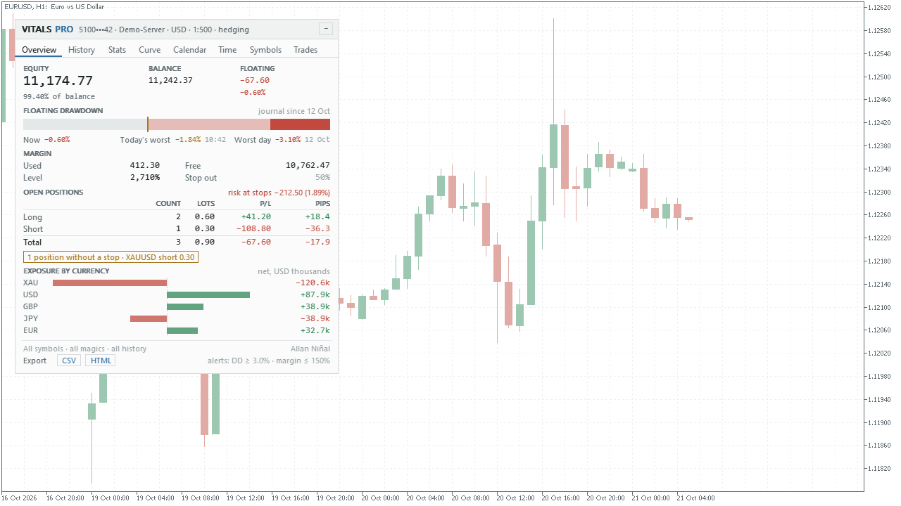

## Get it on the MQL5 Market

The products are not uploaded yet: every link below is **coming soon**.

| Product | Platform | Price | Link |
|---|---|---|---|
| **Vitals Pro** | MT5 | paid | coming soon on the MQL5 Market |
| **Vitals Pro MT4** | MT4 | paid | coming soon on the MQL5 Market |
| Vitals (source on GitHub) | MT5 | free | coming soon on the MQL5 Market |
| Vitals MT4 (source on GitHub) | MT4 | free | coming soon on the MQL5 Market |

The paid card is standalone: you do not need to install the free one to use it.

## What it does

Everything in the free Vitals, on the same card:

- **Overview:** equity, balance and floating result; a floating drawdown bar (now, today's worst, the worst recorded day); margin;
  long, short and total open positions; the risk at the stops; exposure by currency.
- **History:** today, the days before it, week, month and year: trades, wins and losses, net, gain in percent, the worst day's floating
  drawdown, lots; averages per trading day and month.
- **Stats:** win rate, profit factor, expectancy, average win and loss, reward/risk, maximum and relative drawdown, a 60-day Sharpe
  ratio, best and worst day, costs.

And, in Vitals Pro:

- **Curve:** the balance and equity curve over the closed trades, with each day's lowest floating equity as bars underneath.
- **Calendar:** a month grid of the daily net result, with previous and next month.
- **Time:** the net result by hour of entry and by weekday.
- **Symbols:** one row per symbol: trades, win rate, net, costs, profit factor.
- **Trades:** the latest closed trades with their result in R (the loss at the stop is one R), the worst and best price excursion
  during the trade in units of the stop distance, the average R and the longest winning and losing streaks.
- **Alerts:** one for today's floating drawdown reaching a percent of the balance and one for the margin level falling to a level you
  set. Each fires once a day, as a pop-up, a sound, a push notification or an e-mail, each switched separately.
- **Export:** the closed trades as a CSV file and a one-page HTML report, written to the terminal's files folder.

It displays only. It never places, changes or closes an order.

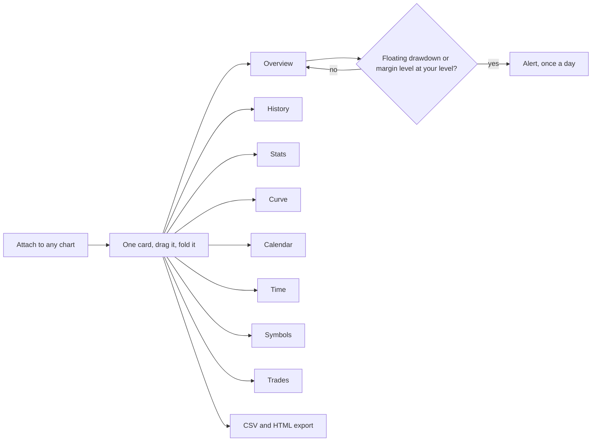

| | |
|---|---|
| 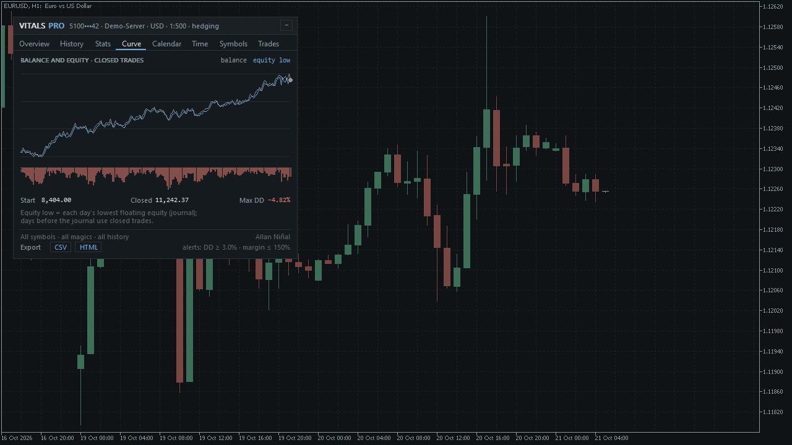 | 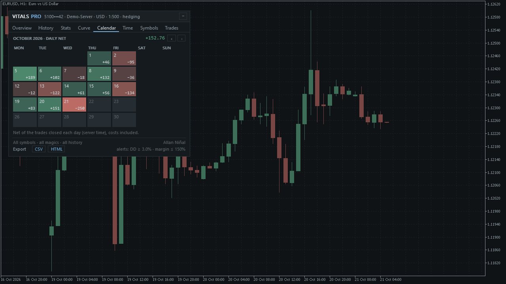 |
| 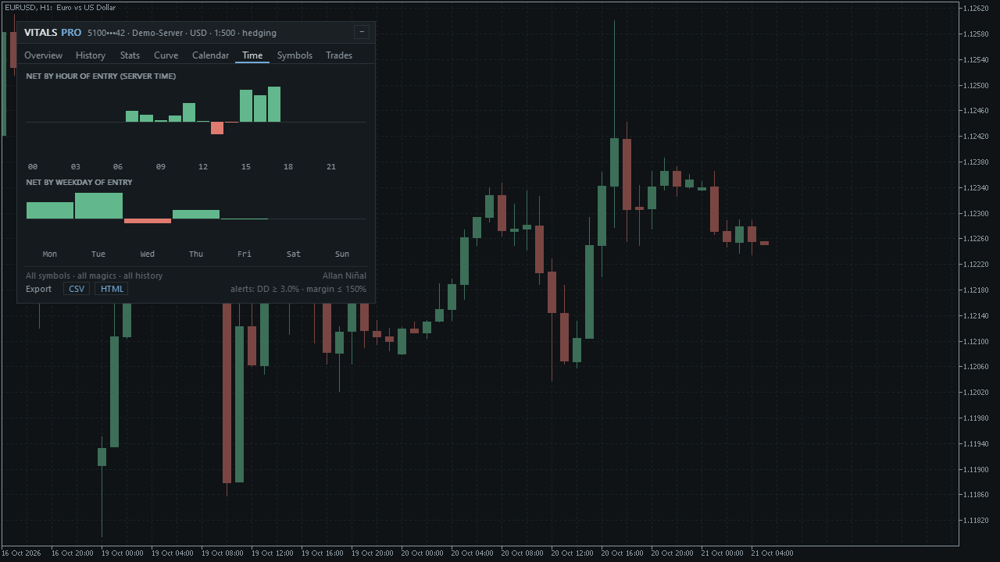 | 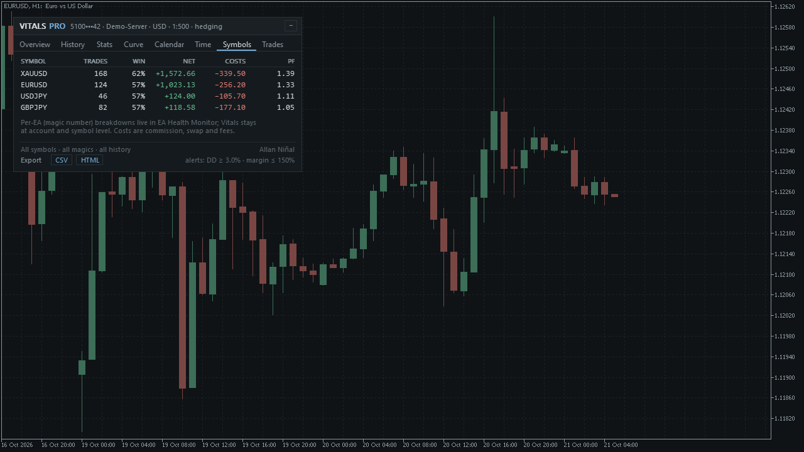 |
| 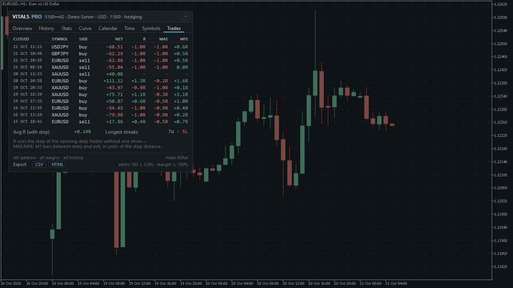 | 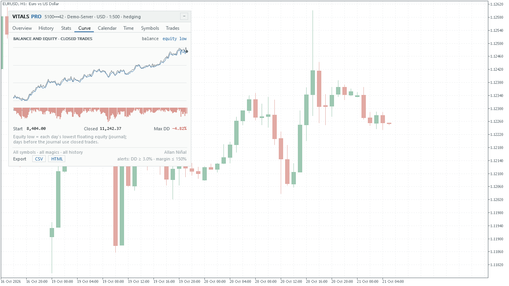 |

MT4 edition screenshots: [overview](images/mt4/overview-light.png), [curve](images/mt4/curve.png),
[calendar](images/mt4/calendar.png), [trades](images/mt4/trades.png). A larger-scale card:
[overview at 150 %](images/mt5/overview-dark-large.png); the card folded to its header: [folded](images/mt5/folded.png).
The screenshots were taken from a test build that feeds the card made-up account data (a demo account), drawn over a normal price
chart. The login on the card is masked and made up. They are illustrations, not trading results.

### What an alert does

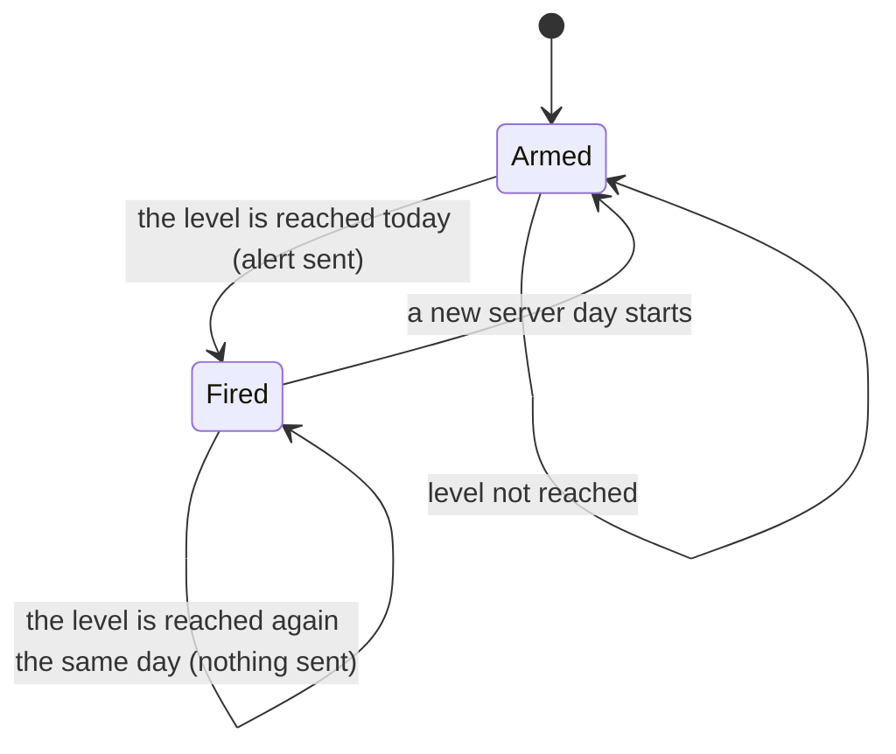

## Who it is for

Traders who want to see the state of the whole account at once and to look back by day, month, hour and symbol, and who want to
be told when the day's floating drawdown or the margin level gets to a level they chose. If you only need the Overview, History and
Stats, the free [Vitals](https://github.com/allanninal/vitals-account-monitor) is enough.

## Why it was built

- **The floating drawdown of each day is missing from a history report**, and MetaTrader keeps no past floating equity. The free card records
  it from the day it is attached; the paid card adds the curve, calendar and alerts that build on that record.
- Our October 2026 scan of the MQL5 Market found many free account dashboards, so the paid edition is for traders who want the
  extra views, the R-multiple trade list and the alerts, not for the basic figures. The same scan found that account panels collect few
  reviews, so this is a niche product, not a claim of mass demand.

## How it was checked (results)

These are results of code checks on synthetic data and on Strategy Tester account histories, not trading results. The test account
was a demo account.

| Check | Platform | Result |
|---|---|---|
| Every number of the card against an independent Python version, 11 synthetic cases | MT5 | 19,799 deals, 75,617 values, 0 mismatches |
| The same, on 4 Strategy Tester runs plus snapshots | MT5 | 21,626 deals, 82,846 values, 0 mismatches |
| The same, orders turned into deals, on 4 Strategy Tester runs plus snapshots | MT4 | 29,590 deals, 12,865 trades, 107,958 values, 0 mismatches |
| The floating-drawdown record through restarts and crashes | MT5 and MT4 | 990 samples, 0 mismatches |
| Validator-style runs ($100 and $100,000 accounts, 5 symbol and timeframe pairs) | MT5 and MT4 | 20 runs each, 0 error lines |
| Empty history | MT5 and MT4 | the card draws (22 screenshots each) |
| Scripted mouse checks (drag, fold, tabs, calendar months, exports, alerts once a day) | MT5 / MT4 | 17 of 17 / 20 of 20 passed |
| Alert fires once a day per level | MT5 and MT4 | confirmed in the scripted checks |

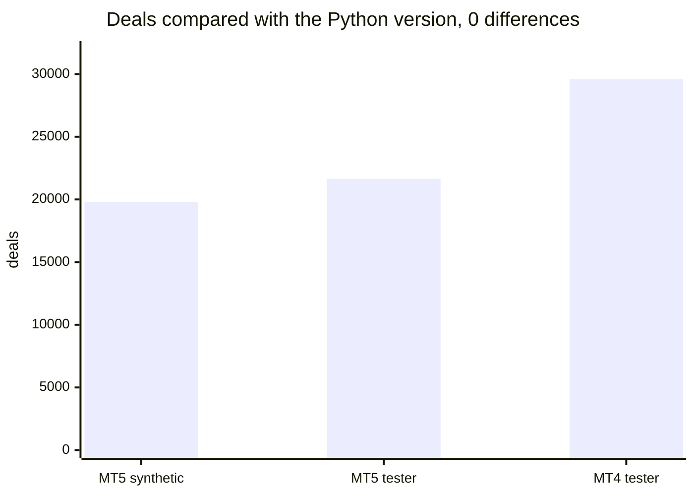

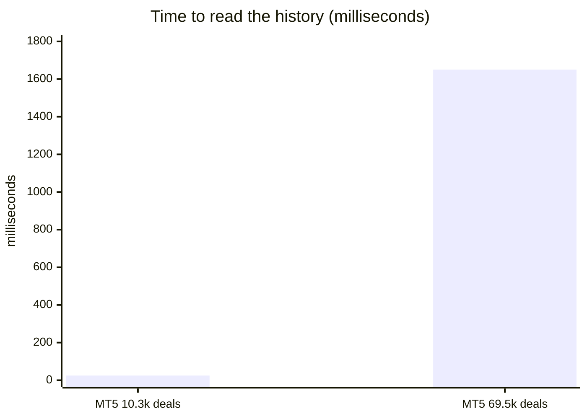

The MT4 reading time is 16 to 156 ms for 1.5 to 6.7 thousand deals. A refresh with a full redraw takes about 1.0 to 1.8 ms on MT5 and about
12 ms on MT4.

## Honest limits

- A card shows history and the account's state. It does not predict the market, and past results are no indication of future results. No
  profit or accuracy claim is made.
- The floating drawdown record **starts the day the card is attached**, because MetaTrader stores no past floating equity. Earlier
  days show the drawdown of the closed-trade curve, marked as an approximation.
- R-multiples need a stop loss on the opening deal; trades without one show a dash.
- It displays and alerts only: it does not close trades or stop trading.
- Alerts need the terminal running; push needs your MetaQuotes ID set up in the terminal.
- Netting accounts were tested on synthetic histories only.
- The source is not published; this repository documents what the product does and the results of its checks.

## Free vs paid

| | Vitals (free) | Vitals Pro (paid) |
|---|---|---|
| Tabs | Overview, History, Stats | Overview, History, Stats, Curve, Calendar, Time, Symbols, Trades |
| Alerts | none | floating drawdown and margin level, once a day each |
| Export | none | CSV and HTML |
| MT5 | coming soon | coming soon |
| MT4 | coming soon | coming soon |
| Source | [public on GitHub](https://github.com/allanninal/vitals-account-monitor) | not published |

---

**Website:** [allanninal.dev/mql5](https://www.allanninal.dev/mql5/#utilities) · [MT4](https://www.allanninal.dev/mql5/#mt4) · [allanninal.dev](https://www.allanninal.dev)
· Questions: message me on [LinkedIn](https://www.linkedin.com/in/allanninal/). All rights reserved, see [LICENSE](LICENSE).
